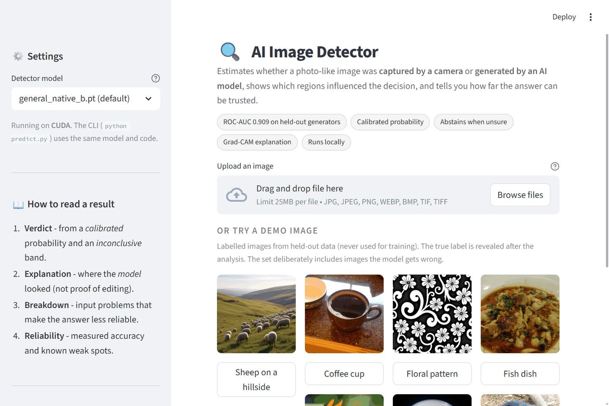
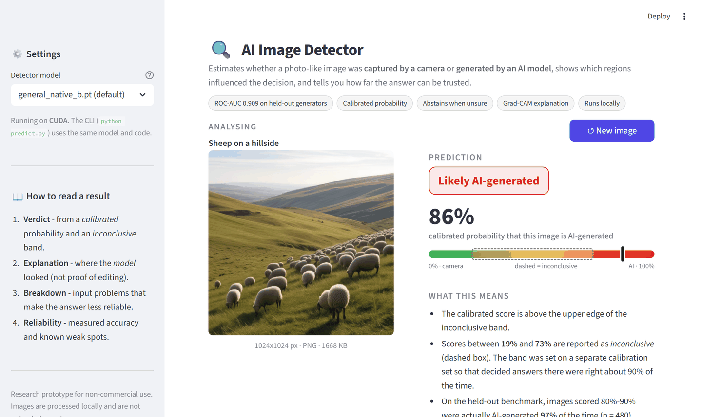
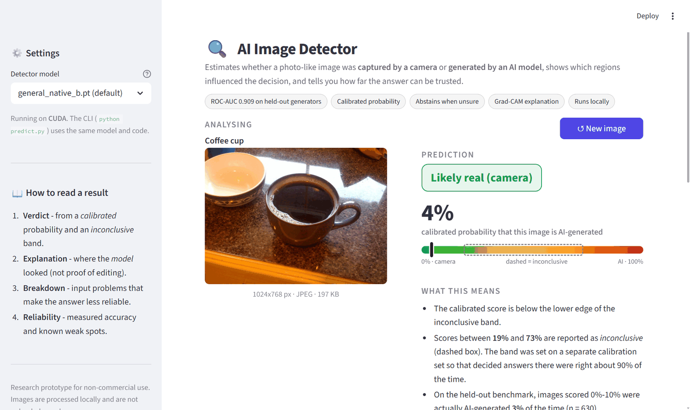
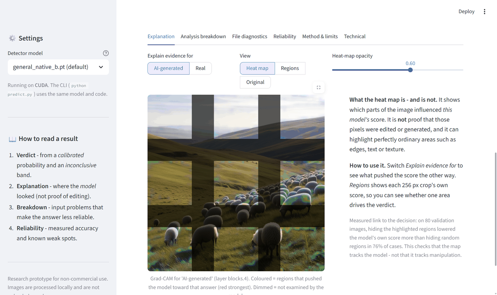
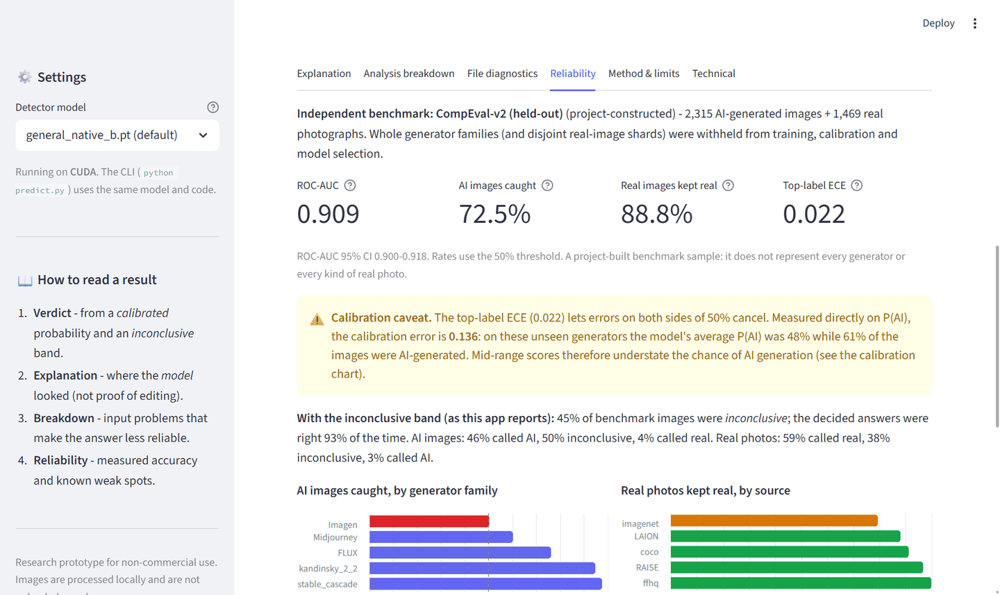
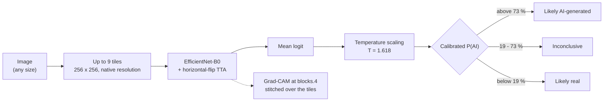
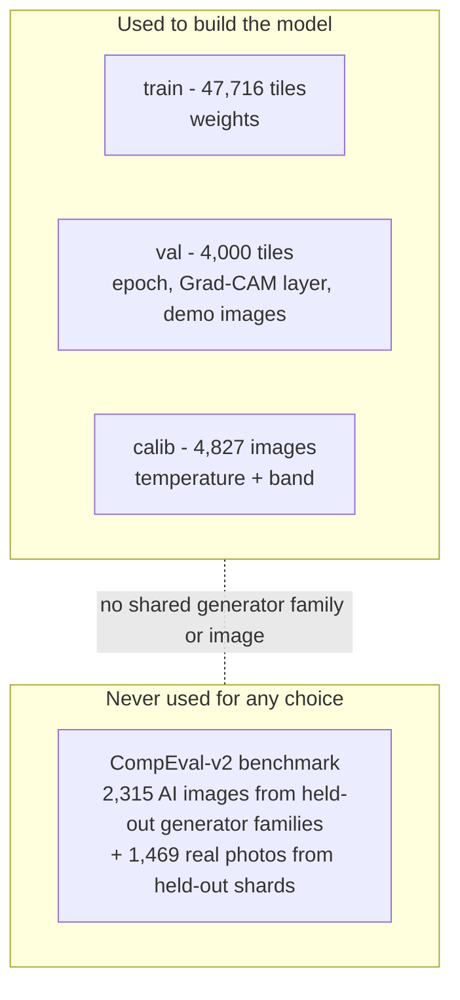

# AI Image Detector

Estimates whether a photo-like image was **captured by a camera** or **generated by an AI model**. It reports a
*calibrated* probability, says "inconclusive" when the evidence is weak, shows which regions influenced the model, and
tells you how far the answer can be trusted - with measured numbers, including where it fails.

> **Research prototype.** The output is a statistical estimate, not forensic proof. It can be confidently wrong and must
> never be the sole basis for a decision about a person or an image. Training and benchmark data are licensed for
> **non-commercial research only** (see [Licences](#14-licences)).



## Contents
1. [What it does](#1-what-it-does)
2. [Screenshots](#2-screenshots)
3. [Quick start (Windows 11)](#3-quick-start-windows-11)
4. [Using the web app](#4-using-the-web-app)
5. [Using the command line](#5-using-the-command-line)
6. [How it works](#6-how-it-works)
7. [Measured results](#7-measured-results)
8. [Limitations and known failure cases](#8-limitations-and-known-failure-cases)
9. [Model history](#9-model-history)
10. [Repository layout](#10-repository-layout)
11. [Configuration and rollback](#11-configuration-and-rollback)
12. [Tests and verification](#12-tests-and-verification)
13. [Security, privacy and SBOM](#13-security-privacy-and-sbom)
14. [Licences](#14-licences)
15. [Troubleshooting](#15-troubleshooting)
16. [Documentation index](#16-documentation-index)
17. [References](#17-references)

## 1. What it does

| feature | what you get |
|---|---|
| **Verdict** | *Likely AI-generated*, *Likely real (camera)* or *Inconclusive*, from a calibrated probability and an abstain band set on a separate calibration split |
| **Calibrated probability** | P(AI) after temperature scaling (T = 1.618), plus how often images with a similar score were actually AI on the benchmark |
| **Explanation** | Grad-CAM heat map for either answer, a per-region view (each 256 px crop's own score), adjustable opacity |
| **Input checks** | warnings for small images, partial coverage, heavy JPEG compression and other conditions known to reduce reliability |
| **File diagnostics** | format, EXIF count, estimated JPEG quality, error-level and spectrum views (context only - the detector does not use them) |
| **Reliability** | measured AUC, detection rate per generator family, false-alarm rate per real-photo source, calibration curve, robustness table |
| **Demo gallery** | 8 labelled held-out images, including ones the model gets wrong; the true label is revealed after each analysis |
| **CLI** | `predict.py` runs the same code path and prints text or one JSON line |

Everything runs locally. Uploaded images are processed in memory and are not sent anywhere.

## 2. Screenshots

All screenshots are of the real app running on the development laptop (RTX 4050, CUDA). The demo images' labels come
from their datasets, as recorded in [samples/manifest.json](samples/manifest.json).

| AI-generated image (label verified: CompEval dataset, Stable Cascade) | Real photo (label verified: Open Images V7, Flickr) |
|---|---|
|  |  |

| Explanation tab (Grad-CAM for the sheep image above) | Reliability tab (measured benchmark numbers) |
|---|---|
|  |  |

The sheep image scores 86 % AI (correct). The coffee photo scores 4 % AI (correct). The gallery also contains an
Imagen 3 image the model misses (11 % AI) and a real photo it wrongly flags (82 % AI); see [samples/README.md](samples/README.md).

Images shown in the screenshots: "Cutting back to one cup of coffee today ;-)" by Daniel Farrell, "Fish Dish" by
Yosomono, "Sunbound" by Kyle Garrity and "Tasman Peninsula" by Prince Roy (Flickr, CC BY 2.0, via Open Images V7); the
AI-generated images are from the Community Forensics evaluation set (CC BY-NC-SA 4.0).

## 3. Quick start (Windows 11)

Requirements: Windows 10/11, Python 3.11 or newer (3.13 tested), about 3 GB of free disk space, internet for the first
setup. An NVIDIA GPU is optional; everything also runs on the CPU.

```powershell
git clone https://github.com/Ishaangor/Deepfake-AI-Image-Detector.git
cd Deepfake-AI-Image-Detector
powershell -ExecutionPolicy Bypass -File scripts\setup.ps1      # one time: .venv, pinned packages, model check
powershell -ExecutionPolicy Bypass -File scripts\run.ps1        # opens http://localhost:8501
```

* `setup.ps1` installs the CUDA 12.4 build of PyTorch when `nvidia-smi` is present and the CPU build otherwise
  (`-Cpu` forces CPU). It ends by verifying the model checksum and calibration and scoring one real image.
* `run.ps1 -Cpu` forces CPU inference; `run.ps1 -Port 8502` uses another port.
* Full instructions, manual installation and every known error: [docs/INSTALLATION_AND_USAGE.md](docs/INSTALLATION_AND_USAGE.md).

**Tested:** a fresh copy of the repository in a short path (`%TEMP%\aidc`) with a new virtual environment, CPU PyTorch,
`setup.ps1 -Cpu` - all checks passed, the smoke prediction agreed with the GPU result (sheep sample: 0.8581 P(AI) on the CPU,
0.8585 on the GPU), and the test suite passed (26 tests). The GPU path was tested on the development laptop. Other machines have not been tested.

## 4. Using the web app

1. Upload a JPG, PNG, WEBP, BMP or TIFF image (up to 25 MB), or click one of the demo images.
2. Read the **verdict** and the **calibrated probability**. The gauge shows the inconclusive band as a dashed box
   (P(AI) between 19 % and 73 %).
3. **What this means** explains the verdict in plain language and says how often images with a similar score were
   actually AI-generated on the benchmark.
4. Tabs: **Explanation** (Grad-CAM / regions), **Analysis breakdown** (input checks, per-region scores),
   **File diagnostics**, **Reliability**, **Method & limits**, **Technical** (model hash, device, timings).
5. **↺ New image** clears the result.

The sidebar lets you switch to the older face-only models for comparison; they are not validated on general images.

## 5. Using the command line

```powershell
.venv\Scripts\python predict.py samples\ai_stable_cascade_sheep.png
.venv\Scripts\python predict.py path\to\image.jpg --json          # one machine-readable JSON line
.venv\Scripts\python predict.py path\to\image.jpg --model candidate_A_mild.pt
```

The JSON output contains `fake_prob`, `real_prob`, `verdict` (`likely_fake` / `likely_real` / `inconclusive`), `band`,
`temperature`, per-tile probabilities, `flags` and `model_id` (architecture, file and hash prefix). The CLI works from any
working directory.

## 6. How it works



* **Native-resolution tiles.** Traces of image generators live in fine pixel statistics, and resizing destroys them. The
  image is therefore cut into up to nine 256 px tiles on a 3 x 3 grid instead of being shrunk. On the validation split this
  scored 0.923 against 0.870 for the resized variant.
* **Calibration.** One temperature parameter fitted on a separate `calib` split (4,827 images, 33 generators) makes the
  probability match observed frequencies; it does not change the ranking.
* **Abstain band.** Set on `calib` so that decided answers there are right about 90 % of the time for each class.
* **Grad-CAM layer** `blocks.4` was chosen on the validation split because it was the most *faithful* (section 7.6).

Data and splits:



Details: [docs/ARCHITECTURE.md](docs/ARCHITECTURE.md) (code structure) and
[docs/MODEL_AND_EVALUATION.md](docs/MODEL_AND_EVALUATION.md) (model, data, every number).

## 7. Measured results

**Benchmark: CompEval-v2 (project-constructed).** This project drew a stratified sample from the public Community Forensics
evaluation set: 2,315 AI images from 8 generators in 5 families that were entirely withheld from training, calibration and
model selection, plus 1,469 real photos from held-out shards. It is not an official leaderboard split. Every number below
comes from `artifacts/eval_general_native_b__v2.json`, produced by `evaluation/metrics.py`.

### 7.1 Headline (clean images, threshold P(AI) = 0.5)

| metric | value | 95 % bootstrap CI |
|---|---|---|
| ROC-AUC | **0.909** | 0.900 - 0.918 |
| AI images detected (recall) | **72.5 %** | 70.7 - 74.3 % |
| Real images kept real (specificity) | **88.8 %** | 87.2 - 90.3 % |
| AI precision | 91.1 % | - |
| AI F1 | 0.807 | 0.794 - 0.820 |
| Balanced accuracy | 80.7 % | 79.4 - 81.9 % |
| Accuracy | 78.8 % | - |
| Brier score | 0.141 | - |
| Top-label ECE (10 bins) | **0.022** | - |
| Class-wise ECE on P(AI) (10 bins) | 0.136 | - |

Confusion matrix: of 2,315 AI images, 1,678 detected and 637 missed; of 1,469 real photos, 1,305 kept real and 164
flagged.

### 7.2 With the inconclusive band (what the app shows)

45.4 % of benchmark images are reported as *inconclusive*. When the app does decide, it is right **93.3 %** of the time
("likely AI" calls 96.1 %, "likely real" calls 90.0 %).

| | called AI | inconclusive | called real |
|---|---|---|---|
| AI images | 45.8 % | 50.1 % | 4.1 % |
| Real photos | 2.9 % | 38.1 % | 59.0 % |

### 7.3 Per generator and per real-image source

| AI generator (held-out) | n | detected |
|---|---|---|
| Imagen 3 | 252 | **50 %** |
| Midjourney v6.1 | 249 | **53 %** |
| Midjourney v5.2 | 350 | **56 %** |
| FLUX-schnell | 302 | 73 % |
| Midjourney v6 (community model) | 257 | 74 % |
| FLUX-dev | 339 | 79 % |
| Kandinsky 2.2 | 255 | 95 % |
| Stable Cascade | 311 | 98 % |

| real-photo source | n | kept real |
|---|---|---|
| FFHQ (faces) | 126 | 100 % |
| RAISE (raw camera photos) | 126 | 97 % |
| COCO | 126 | 91 % |
| LAION (web images) | 867 | 88 % |
| ImageNet | 224 | **79 %** |

With a few hundred images per row, each rate is uncertain by roughly ± 6 percentage points.

### 7.4 Calibration

The top-label ECE of 0.022 means confidence in the *decided* class matches accuracy. But on these unseen generators the
model's P(AI) runs **too low in the middle range**: the mean predicted P(AI) is 0.48 while 61 % of the images are AI. A
score of 30-40 % AI was AI-generated 59 % of the time. Treat mid-range scores as "uncertain", not as "probably real".

### 7.5 Robustness (same images, degraded before scoring)

| condition | ROC-AUC | AI detected | real kept real |
|---|---|---|---|
| original | 0.909 | 72.5 % | 88.8 % |
| JPEG quality 75 | 0.938 | 86.2 % | 87.5 % |
| JPEG quality 50 | 0.954 | 84.2 % | 92.3 % |
| social-media style (≤ 1080 px + JPEG 70) | 0.941 | 86.0 % | 87.5 % |
| grayscale | 0.926 | 74.8 % | 91.5 % |
| Gaussian blur (σ = 1) | 0.881 | 76.3 % | 82.3 % |
| half size | 0.842 | 73.1 % | 80.9 % |
| quarter size | **0.763** | 74.2 % | **67.9 %** |

AUC *rises* after JPEG compression because every AI image in the benchmark is a PNG file while most real photos are JPEG;
recompression removes that format difference. The clean row is therefore the conservative headline.

### 7.6 Explanation faithfulness

On 80 correctly classified validation tiles, removing the regions Grad-CAM (`blocks.4`) highlights lowered the model's score
faster than removing random regions - and revealing them restored it faster - in **76 %** of cases (`bn2`: 58 %,
`blocks.2`: 46 %). Maps from a network with randomised weights were uncorrelated with the real maps (mean Spearman ρ ≈ 0.01).
This shows the map is connected to the model's decision. It does **not** show that highlighted pixels were manipulated.

### 7.7 Speed

For a 1024 x 1024 image (9 tiles), after the model is loaded: about 0.05 s for the score and 0.4 s for Grad-CAM on the
RTX 4050 laptop GPU; about 0.35 s and 1.9 s on the laptop CPU (3 repeats, development laptop only).

## 8. Limitations and known failure cases

| limitation | evidence | what to do |
|---|---|---|
| **Imagen 3 and Midjourney** are caught only about half the time | 50 %, 53 %, 56 % detection (section 7.3) | do not rely on a "real" or "inconclusive" answer for images that could come from these |
| **ImageNet-style real photos** are flagged as AI about 1 time in 5 | 79 % kept real | treat an AI verdict on older, low-quality web photos with caution |
| **Low resolution** destroys the signal | quarter size: AUC 0.763, a third of real photos flagged | the app warns below 256 px; prefer the original file |
| **Scores understate AI on unseen generators** | mean P(AI) 0.48 vs 61 % actual; class-wise ECE 0.136 | read 20-60 % as uncertain |
| **Many images are inconclusive** | 45.4 % of the benchmark | this is by design; the app abstains rather than guesses |
| **Format confound in the benchmark** | all AI images are PNG; AUC rises after JPEG recompression | the clean figure is the conservative one |
| **Partial coverage on large images** | 9 tiles of 256 px; e.g. 56 % of a 1024 x 1024 image | the app shows coverage and dims unexamined areas |
| **Only measured sources are known** | 8 generators, 5 real sources | anything else (new generators, phone pipelines, screenshots, heavy editing) is untested |
| **Heat maps are not proof** | faithfulness test measures link to the model, not to manipulation | use them to understand the model, not to locate edits |
| **Face photos** | `tests/assets/face_real.jpg` scores 85 % AI (a false alarm); `face_fake.jpg` is inconclusive (67 %) | the general model was not built for face-swap deepfakes |
| **Single training run, not retrained** | the shipped checkpoint is epoch 4 of a run that crashed (section 9) | a clean retrain might score slightly higher |
| **Possible identity overlap** | FFHQ-style portraits may share identities between training and benchmark | the FFHQ 100 % figure may be optimistic |

`tests/assets/Fakers.jpg`, `fake_20.png` and `real_20.png` have **no verified labels**; their scores support no claim.

## 9. Model history

| run | data | val composite | independent result | status |
|---|---|---|---|---|
| face models (`best_finetuned`, `candidate_A/B`) | teammate face datasets | - | face-only | kept for comparison and rollback |
| `general_native_a` | Community Forensics + Open Images | 0.923 | CompEval-v1 AUC **0.688** | did not generalise; superseded |
| `general_glob_a` | same, resized view | 0.870 | not benchmarked | not shipped |
| **`general_native_b`** | + CompEval-derived pool | **0.850** (epoch 4) | CompEval-v2 AUC **0.909** | **shipped** |

The val composites of `native_b` and `native_a` use different validation sets and are not comparable.

**What exactly is shipped.** Two training runs of the same configuration wrote to the same checkpoint and log paths. An
8-epoch run reached val composites up to 0.866 at epoch 6, but its log and checkpoint were overwritten by the second
run, so those values survive only in console output and cannot be reproduced from this repository. The second, 6-epoch
run logged 0.764, 0.814, 0.843 and 0.850 for epochs 1-4 (`artifacts/train_general_native_b.json`) and crashed during
epoch 5 with a Windows paging-file error (1455). The shipped model is **the epoch-4 checkpoint of that second run**
(val composite 0.850). It was calibrated and benchmarked once. CompEval-v1 was looked at before the decision to retrain,
so it was retired as a test set; CompEval-v2 was built afterwards. Full record: [docs/EXPERIMENTS.md](docs/EXPERIMENTS.md).

## 10. Repository layout

```
app.py                  Streamlit web UI
predict.py              command-line interface (same code path)
detector/               inference package: model loading, tiling, Grad-CAM, file diagnostics, paths
models/                 checkpoints (+ SHA256SUMS), calibration (*.meta.json), model cards (*.card.json)
samples/                8 labelled demo images + manifest.json (source, licence, label provenance)
evaluation/             benchmark scoring, metrics, model card, explanation faithfulness
training/               data builders and training / finalisation scripts
artifacts/              measured results (JSON/Markdown) that the docs and the UI read
scripts/                setup.ps1, run.ps1, check_env.py, generate_sbom.ps1
tests/                  pytest suite + test images
sbom/                   CycloneDX SBOM and pip-audit report
docs/                   guides (see section 16) and screenshots
legacy/                 original Keras Xception app and scripts (rollback only)
data/                   datasets - large parts are git-ignored; see data/README.md
```

Most folders have their own README explaining their files.

## 11. Configuration and rollback

| setting | effect |
|---|---|
| `models/active_model.json` | default checkpoint (`general_native_b.pt`) |
| `DETECTOR_MODEL=candidate_A_mild.pt` | use another checkpoint from `models/` |
| `DETECTOR_DEVICE=cpu` | force CPU (same as `run.ps1 -Cpu`) |
| `DETECTOR_BACKEND=legacy` | original Keras Xception UI/CLI (needs TensorFlow) |
| `.streamlit/config.toml` | 25 MB upload limit, listens on localhost only, no usage statistics |

See [.env.example](.env.example). The original face model `models/best_finetuned.pt` is unchanged.

## 12. Tests and verification

```powershell
.venv\Scripts\python -m pytest              # 26 tests, about 1-2 minutes on the GPU laptop
.venv\Scripts\python scripts\check_env.py --smoke
```

The tests check, among other things, that the app and the CLI give exactly the detector's number for the same image,
that calibration and band are applied, that the demo manifest's hashes and provenance are complete, that uploads only
reach the advertised image decoders, that the CLI works from another directory, and that the face-model path never loads
unrelated models. Last run: 26 passed on the development laptop (GPU) and 26 passed in the clean CPU environment.

## 13. Security, privacy and SBOM

* **Privacy:** images are processed locally in memory; the server listens on `localhost` only and Streamlit usage
  statistics are off. Nothing is uploaded.
* **Untrusted files:** uploads are limited to 25 MB and decoded only as JPEG, PNG, WEBP, BMP or TIFF, whatever their
  extension. Checkpoints are loaded with `torch.load(weights_only=True)`; `check_env.py` verifies them against
  `models/SHA256SUMS`.
* **SBOM:** [sbom/sbom.cdx.json](sbom/sbom.cdx.json) (CycloneDX 1.6, 73 components, schema-validated). Vulnerability scan:
  [sbom/pip-audit.json](sbom/pip-audit.json). **Open item:** `torch 2.6.0` has 22 published advisories (fixed in
  2.7-2.13, some unfixed). Pillow and setuptools were upgraded to clear theirs. Details and the risk assessment:
  [docs/SBOM.md](docs/SBOM.md).

## 14. Licences

* **Code:** the repository has no `LICENSE` file yet, so no open-source licence is granted. The team should choose one.
* **Training and benchmark data:** Community Forensics and its evaluation set are **CC BY-NC-SA 4.0** (non-commercial,
  share-alike). Models trained on them should be treated as research-only.
* **Real photos:** Open Images V7 (images CC BY 2.0 as listed per image; annotations CC BY 4.0).
* **Pretrained backbone:** EfficientNet-B0 ImageNet weights via timm (Apache-2.0).
* **Demo images:** each image's author, licence and source URL are in [samples/manifest.json](samples/manifest.json).
* **Teammate face datasets** in `data/` (from an earlier commit) have **undocumented licences**. Confirm them before
  making the repository public.

Full audit, including every Python dependency: [docs/LICENSES.md](docs/LICENSES.md).

## 15. Troubleshooting

| problem | fix |
|---|---|
| `running scripts is disabled on this system` | use `powershell -ExecutionPolicy Bypass -File scripts\...` as shown above |
| `Python 3.11 or newer was not found` | install Python 3.13 from python.org with "Add python.exe to PATH" |
| `WinError 206` / path too long during install | clone to a short path such as `C:\aidetector`, or enable Windows long paths |
| CUDA error, driver mismatch, out of GPU memory | `scripts\run.ps1 -Cpu` |
| `port 8501 is already in use` | `scripts\run.ps1 -Port 8502` |
| `model checkpoint checksum` FAIL | re-download the file; a file of about 130 bytes means a Git LFS pointer was checked out |

More: [docs/INSTALLATION_AND_USAGE.md](docs/INSTALLATION_AND_USAGE.md).

## 16. Documentation index

| document | for |
|---|---|
| [docs/PROJECT_GUIDE.md](docs/PROJECT_GUIDE.md) | a plain-language tour of the project, its goals and decisions |
| [docs/INSTALLATION_AND_USAGE.md](docs/INSTALLATION_AND_USAGE.md) | step-by-step Windows setup, usage and troubleshooting |
| [docs/DEMO_GUIDE.md](docs/DEMO_GUIDE.md) | a 5-minute demo script with fallbacks |
| [docs/ARCHITECTURE.md](docs/ARCHITECTURE.md) | code structure and data flow |
| [docs/MODEL_AND_EVALUATION.md](docs/MODEL_AND_EVALUATION.md) | the model, data splits and every measured number |
| [docs/EXPERIMENTS.md](docs/EXPERIMENTS.md) | experiment record and decisions |
| [docs/FAQ_AND_VIVA.md](docs/FAQ_AND_VIVA.md) | likely questions with honest answers |
| [docs/SBOM.md](docs/SBOM.md) | software bill of materials and vulnerability scan |
| [docs/LICENSES.md](docs/LICENSES.md) | licence audit of code, dependencies, weights and data |

## 17. References

1. J. Park and A. Owens. *Community Forensics: Using Thousands of Generators to Train Fake Image Detectors.* CVPR 2025.
   Dataset: <https://huggingface.co/datasets/OwensLab/CommunityForensics>
2. M. Tan and Q. V. Le. *EfficientNet: Rethinking Model Scaling for Convolutional Neural Networks.* ICML 2019.
3. C. Guo, G. Pleiss, Y. Sun and K. Q. Weinberger. *On Calibration of Modern Neural Networks.* ICML 2017 (temperature scaling).
4. R. R. Selvaraju et al. *Grad-CAM: Visual Explanations from Deep Networks via Gradient-based Localization.* ICCV 2017.
5. V. Petsiuk, A. Das and K. Saenko. *RISE: Randomized Input Sampling for Explanation of Black-box Models.* BMVC 2018
   (deletion / insertion metrics).
6. J. Adebayo et al. *Sanity Checks for Saliency Maps.* NeurIPS 2018 (weight-randomisation test).
7. A. Kuznetsova et al. *The Open Images Dataset V4.* IJCV 2020.
8. R. Wightman. *PyTorch Image Models (timm).* <https://github.com/huggingface/pytorch-image-models>
