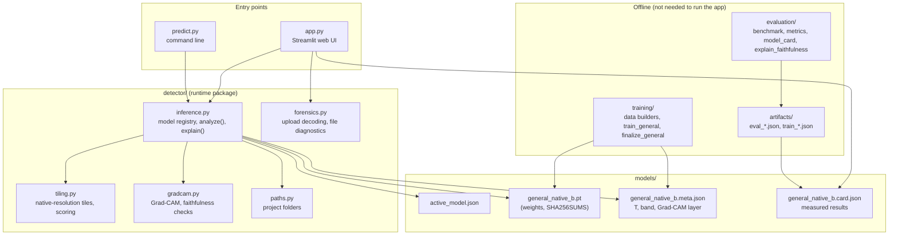
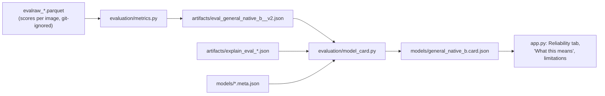

# Architecture

How the code is organised and how an image travels through it. For the model itself and the measured numbers see
[MODEL_AND_EVALUATION.md](MODEL_AND_EVALUATION.md).

## 1. Components



* `app.py` and `predict.py` contain **no inference logic** of their own. Both call `detector.analyze()`; the tests check
  that they print exactly the detector's number for the same image.
* `detector/paths.py` derives every folder from the package location, so the app, the CLI, the scripts and the tests
  work from any working directory.
* Everything under "Offline" produced the files in `models/` and `artifacts/`; none of it runs when you use the app.

## 2. What happens when you analyse an image

```mermaid
sequenceDiagram
    participant U as User
    participant A as app.py
    participant F as forensics
    participant I as inference.analyze
    participant T as tiling
    U->>A: upload bytes (max 25 MB) or click a demo image
    A->>F: open_upload(bytes) - JPEG/PNG/WEBP/BMP/TIFF decoders only
    A->>F: file_info(bytes) - format, size, EXIF count, JPEG quality
    A->>I: analyze(image, model)
    I->>I: load checkpoint once per process (weights_only=True), read T and band from meta.json
    I->>T: up to 9 tiles of 256 x 256 at native resolution
    T->>T: EfficientNet-B0 on each tile and its mirror image
    T-->>I: tile logits
    I->>I: mean logit / T -> P(real), P(AI); band -> verdict; input-quality flags
    I-->>A: Result (probabilities, verdict, tile boxes and scores, flags, model_id)
    A->>I: explain(image, evidence_for) - Grad-CAM at blocks.4, stitched over the tiles
    A-->>U: verdict card, gauge, explanation, tabs
```

Results are cached per image and model (`st.cache_data`), so switching tabs or the heat-map target does not re-run the
network. Checkpoints are loaded once per process.

## 3. Key types

| type | fields that matter |
|---|---|
| `Result` | `fake_prob`, `real_prob`, `verdict` (`likely_fake` / `likely_real` / `inconclusive`), `band`, `temperature`, `boxes` and per-tile probabilities, `flags`, `model_id` (`arch:file@sha256-prefix`), `kind` (`general` or face) |
| `Explanation` | `base` (analysed RGB image), `heat` (Grad-CAM map), `examined` (mask of pixels any tile covered), `layer` |
| `*.meta.json` | `temperature`, `band` (on P(real)), `explain_layer`, calibration-set statistics |
| `*.card.json` | benchmark metrics, per-family and per-source rates, reliability bins, robustness, verdict statistics, limitations - all generated by `evaluation/model_card.py` from `artifacts/` |

## 4. Models and the registry

* `models/active_model.json` names the default checkpoint (`general_native_b.pt`). Without it the fallback is the
  original face model `best_finetuned.pt`.
* `DETECTOR_MODEL` or `--model` select another checkpoint; the app's sidebar lists every `models/*.pt` file.
* General models (`general_*`) tile the whole image. The older face models crop the largest face (OpenCV Haar cascade)
  when their validated crop policy says so.
* `DETECTOR_BACKEND=legacy` routes `app.py` and `predict.py` to the original Keras Xception code in `legacy/`.
* `DETECTOR_DEVICE=cpu` forces the CPU; otherwise CUDA is used when available.

## 5. Where the UI's numbers come from



No number in the UI is typed by hand: the Reliability tab, the "What this means" sentence and the limitation list are all
read from the model card.

## 6. Tests

`tests/test_detector.py` drives the real app with Streamlit's `AppTest`, runs the CLI as a subprocess from another
directory, and checks calibration, the demo manifest (hashes, labels, licences), device override, upload decoding, the
file diagnostics and the reset button. `tests/test_parquet_stream.py` tests the streaming data reader and skips one case
when a training shard is not downloaded.
